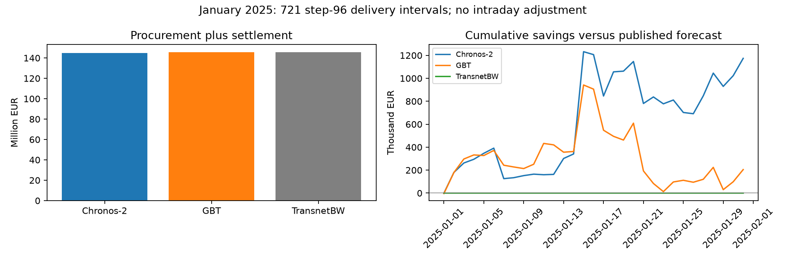

# Energy Forecasting — Evaluation Overview

## 1. Evaluation Choice and Assumptions

We assume **TransnetBW issues a rolling 24-hour residual-load forecast every hour**, following the same schedule as Chronos-2 and GBT in this project. We interpret each forecast as an estimate of residual-load requirements for future delivery intervals, relevant to generation and supply planning.

For **forecast direction and asymmetric weighted loss**, we evaluate only the prediction at **horizon step 96 (24 hours ahead)** from each hourly forecast:

- **Reason:** We want to assess how accurately each model anticipates residual load for a delivery interval at a consistent 24-hour lead time, under the assumed TransnetBW forecasting schedule.
- **Selection:** Each forecast produces 96 predictions, but only its last prediction contributes to forecast-direction metrics and asymmetric weighted loss.
- **Aggregation:** Calculate the error and loss for each selected prediction, then aggregate across forecast origins using a simple arithmetic mean where appropriate.
- **Overall accuracy:** MAE and RMSE use all 96 steps of every forecast to measure general prediction accuracy.
- **Interpretation:** Step 96 corresponds to **one 15-minute interval at the end of the 24-hour horizon**, not the sum of energy required during the entire day. Selected target intervals are one hour apart because forecasts are issued hourly.
- **TransnetBW assumptions:** Use an hourly rolling 24-hour forecasting schedule for this comparison. Assume the benchmark forecasts include a safety margin against underestimating residual-load requirements.

## 2. Forecasting Setup

- **Models:** Chronos-2 and Gradient Boosting Tree (GBT).
- **Benchmark:** TransnetBW residual-load forecasts.
- **Target:** Actual residual load.
- **Data and prediction resolution:** 15 minutes.
- **Lookback:** 672 observations (previous 7 days).
- **Forecast horizon:** 96 observations (next 24 hours).
- **Forecast step:** 4 observations (one new forecast every hour).
- **TransnetBW forecast frequency:** Assumed hourly for this evaluation.
- **Forecast output:** 96 predictions per forecast origin.
- **Evaluation period for the results below:** January 1-31, 2025, in Europe/Berlin time (`2025-01-01` inclusive to `2025-02-01` exclusive), from the Chronos-2 experiment referenced by `src/demo/config.yaml`. This explicitly differs from the original two-week requirement; the full-month period was selected for this table. Both evaluated models and the downloaded actual residual-load series use identical target values. TransnetBW is included as a delivery-time benchmark; its forecast issue times and revisions are unverified.

The specified setup uses the preceding 672 observations to predict the next 96 intervals. The saved Chronos-2 run follows this; the saved GBT run requires 676 observations because of its additional one-hour lag-availability buffer (see the audit below). After one hour, four new observations become available and another forecast is issued. **No hourly aggregation is performed.**

- **MAE and RMSE:** All 96 horizon steps.
- **Forecast direction and asymmetric weighted loss:** Only step 96 from each forecast.
- **Saved identifiers:** `forecast_origin`, `horizon_step`, `target_timestamp`, prediction, and actual value.

## 3. Evaluation Metrics

### A. Forecast Accuracy — All 96 Horizon Steps

**Notation used in this section:**

- **Forecast origin ( $o$ ):** The time a new 96-step forecast is issued; origins are spaced one hour apart.
- **Horizon step ( $h$ ):** Position within a forecast, from 1 to 96; each step represents 15 minutes.
- **Actual residual load ( $y_{o,h}$ ):** Actual value for the target interval at step $h$ from origin $o$.
- **Predicted residual load ( $\hat{y}_{o,h}$ ):** Forecast for the same target interval.
- **Signed error ( $e_{o,h}$ ):** Prediction minus actual; positive indicates overprediction.
- **Evaluation pairs ( $\mathcal{P}$ ):** Set of valid forecast-origin and horizon-step pairs; $N=|\mathcal{P}|$ is its size.

$$
e_{o,h}=\hat{y}_{o,h}-y_{o,h}
$$

- **Mean Absolute Error (MAE):** Average magnitude of errors across all 96 forecast steps. Lower is better.

$$
\mathrm{MAE}=\frac{1}{N}\sum_{(o,h)\in\mathcal{P}}|e_{o,h}|
$$

- **Root Mean Squared Error (RMSE):** Square root of the mean squared error. Larger errors have a greater effect on RMSE. Lower is better.

$$
\mathrm{RMSE}=\sqrt{\frac{1}{N}\sum_{(o,h)\in\mathcal{P}}e_{o,h}^{2}}
$$

### B. Forecast Direction — Horizon Step 96 Only

For each **forecast origin ( $o$ )**, evaluate only the prediction at **step 96**. Define its **signed error ( $e_o$ )** as:

$$
e_o=\hat{y}_{o,96}-y_{o,96}
$$

- **Overprediction ( $e_o>0$ ):** The prediction exceeds actual residual load.
- **Underprediction ( $e_o<0$ ):** The prediction is below actual residual load.
- **Exact prediction ( $e_o=0$ ):** No forecasting error.
- **Number of evaluated origins ( $M$ ):** Hourly forecast origins with an available prediction and actual value at step 96. All sums in this section run over these origins.

**Direction metrics:**

- **Mean Bias:** Average signed error at the 24-hour lead time. Positive bias indicates an overall tendency to overpredict; negative bias indicates an overall tendency to underpredict.

$$
\mathrm{Bias}_{24h}=\frac{1}{M}\sum_o e_o
$$

- **Overprediction Rate (%):** Percentage of selected forecasts above the actual value.

$$
\mathrm{Overprediction\ Rate}_{24h}=\frac{\#\{o:e_o>0\}}{M}\times100\%
$$

- **Underprediction Rate (%):** Percentage of selected forecasts below the actual value.

$$
\mathrm{Underprediction\ Rate}_{24h}=\frac{\#\{o:e_o<0\}}{M}\times100\%
$$

- **Total Overprediction:** Sum of positive error magnitudes for the selected forecasts.

$$
\mathrm{Total\ Overprediction}_{24h}=\sum_o\max(e_o,0)
$$

- **Total Underprediction:** Sum of underprediction magnitudes, reported as positive quantities.

$$
\mathrm{Total\ Underprediction}_{24h}=\sum_o\max(-e_o,0)
$$

Zero-error predictions count toward neither direction rate. These totals represent **only the selected final-step intervals**, not the entire daily energy excess or shortfall.

### C. Asymmetric Weighted Loss — Horizon Step 96 Only

**Assumption:** Underprediction is **twice as costly** as overprediction.

- **Underprediction magnitude:** $\max(y_{o,96}-\hat{y}_{o,96},0)$; positive only when predicted residual load is below actual load.
- **Overprediction magnitude:** $\max(\hat{y}_{o,96}-y_{o,96},0)$; positive only when predicted residual load exceeds actual load.
- **Weight ( $\alpha$ ):** Set $\alpha=\frac{2}{3}$ for underprediction and $1-\alpha=\frac{1}{3}$ for overprediction, giving a **2:1 penalty ratio**.
- **Weighted loss ( $L_o$ ):** Penalty for the selected final-step prediction from origin $o$.

$$
L_o=\alpha\max(y_{o,96}-\hat{y}_{o,96},0)
+(1-\alpha)\max(\hat{y}_{o,96}-y_{o,96},0)
$$

With $\alpha=\frac{2}{3}$:

$$
L_o=\frac{2}{3}\max(y_{o,96}-\hat{y}_{o,96},0)
+\frac{1}{3}\max(\hat{y}_{o,96}-y_{o,96},0)
$$

- **Average Weighted Loss:** Simple arithmetic mean of the selected final-step losses across the $M$ forecast origins. Lower is better.

$$
\overline{L}_{24h}=\frac{1}{M}\sum_o L_o
$$

The weighted loss is a **hypothetical cost-sensitive evaluation score**, not a monetary market-cost simulation.

## 4. Evaluation Procedure

1. Generate a 96-step forecast at 15-minute resolution every hour for Chronos-2 and GBT.
2. Match each prediction to the actual residual load of its target interval.
3. Compute **MAE and RMSE across all 96 forecast steps**.
4. Filter to **`horizon_step == 96`**, keeping one final-step prediction per forecast origin.
5. Compute **forecast-direction metrics and asymmetric weighted loss** for the filtered predictions.
6. Compare GBT and Chronos-2 on aligned target intervals and lead times. Join the published TransnetBW residual-load forecasts by delivery timestamp; its issue times and lead times cannot be verified from the exports.

## 5. Final Model Comparison

**Evaluated period: January 1-31, 2025 (Europe/Berlin).** Recomputed from saved forecasts on 2026-11-25; no retraining. There are **721 hourly forecast origins**, **69,216 forecast pairs** for MAE/RMSE, and **721 step-96 predictions** for direction and weighted loss. Both models have identical forecast keys and actual labels.

| Metric | Evaluation Scope | Chronos-2 | GBT | TransnetBW (delivery-matched) |
|---|---|---:|---:|---:|
| MAE (MWh) | All 96 horizon steps | 182.52 | 174.91 | 145.68 |
| RMSE (MWh) | All 96 horizon steps | 253.59 | 226.28 | 169.05 |
| Mean Bias (MWh) | Step 96 only | -43.78 | -2.66 | 127.34 |
| Overprediction Rate (%) | Step 96 only | 46.74 | 49.65 | 86.41 |
| Underprediction Rate (%) | Step 96 only | 53.26 | 50.35 | 13.45 |
| Total Overprediction (MWh) | Step 96 only | 69,613.09 | 62,196.28 | 98,900.50 |
| Total Underprediction (MWh) | Step 96 only | 101,177.23 | 64,116.81 | 7,086.25 |
| **Average Weighted Loss (2:1, MWh)** | **Step 96 only** | 125.74 | 88.04 | 52.28 |

Positive bias means **overprediction** here: error is `prediction - actual`, the negative of the saved `residual` column. The normalized weighted loss is `(2 * underprediction + overprediction) / 3`, averaged over the 721 selected forecasts. It is not a euro cost. Neither GBT nor Chronos-2 has an exact step-96 prediction in this sample. TransnetBW has one exact match among the 721 selected intervals (0.14%), so its under- and overprediction rates do not sum to 100%.

The step-96 delivery timestamps run from **January 1 at 23:45 to January 31 at 23:45**, one hour apart. Their summed errors cover those 721 quarter-hour intervals only, not all 2,976 January intervals. The earlier daily-block energy totals in the model-results report use a different selection and are not used in this table.

**TransnetBW scope and caveat:** Both supplied exports contain `Residual load [MWh] Original resolutions`; that column is used here. For MAE/RMSE, the published value for each delivery timestamp is joined to every corresponding model forecast pair, giving the same 69,216-row delivery weighting. These are repeated uses of 2,976 published values, not evidence of 721 archived hourly forecast vintages. For direction and loss, only the 721 delivery timestamps selected by the models' step 96 are used. The exports contain no issuance timestamp or revision identifier, so these benchmark forecasts cannot be verified as 24-hour-ahead forecasts. The hourly issue schedule and safety margin in section 1 remain assumptions. For reference, scoring each January delivery interval once gives published MAE **146.42 MWh** and RMSE **169.53 MWh**; that different weighting is not used in the table above.

Sources: [Chronos-2 saved predictions](../outputs/runs/20261117T112048694811Z_chronos2-15min-evaluation_9284b2e63425/predictions/final_test.csv), [GBT saved predictions](../outputs/runs/20261125T085051149324Z_gradient-boosting-residual-load-january-2025_afl2t6ia/predictions/final_test.csv), [full-precision metrics and verification](../outputs/runs/20261125T085051149324Z_gradient-boosting-residual-load-january-2025_afl2t6ia/metrics/evaluation_overview_january_step96.json), and [the 721 aligned step-96 forecasts and losses](../outputs/runs/20261125T085051149324Z_gradient-boosting-residual-load-january-2025_afl2t6ia/predictions/evaluation_overview_step96.csv).

Benchmark sources: [actual residual-load export](../Dataset/raw/csv/Actual_consumption_202101010000_202601010000_Quarterhour.csv), [forecast residual-load export](../Dataset/raw/csv/Forecasted_consumption_202101010000_202601010000_Quarterhour.csv). [The aligned January residual-load values](../outputs/runs/20261125T085051149324Z_gradient-boosting-residual-load-january-2025_afl2t6ia/predictions/transnetbw_residual_january.csv) and the metrics JSON retain the values and source hashes used here.

## 6. GBT Conformance Check

The audit checks the saved residual-load run, not the older grid-load experiment. Source CSV rows were checked directly, in addition to the saved configuration.

| Requirement | Evidence from the saved GBT run | Status |
|---|---|---|
| Residual-load target at 15-minute resolution | `Residual load [MWh]`; actual labels match Chronos-2 for every forecast pair | Matches |
| Forecast horizon: 96 observations | Every origin has exactly steps 1-96 on a 15-minute grid | Matches |
| Forecast step: 4 observations | All 721 origins are exactly one hour apart | Matches |
| Output: 96 predictions per origin and saved identifiers | 69,216 rows; origin, cutoff, target timestamp, horizon step, actual, prediction and residual are present | Matches |
| MAE/RMSE across all horizon steps | Recomputed across all 69,216 aligned pairs | Matches |
| Direction and 2:1 loss at step 96 only | Recomputed for this table using exactly 721 final-step rows | Matches now; the earlier daily-block analysis used a different scope |
| Evaluation period: original two-week requirement | Saved run covers January 1-31; all forecast targets stay within that month | Deviation from original requirement; full January selected for this table |
| Lookback: 672 observations | GBT uses 676 rows (169 hours), including the 60-minute availability buffer | Does not match; requires a separate model/preprocessing change for strict compliance |
| Same actual values for both models and benchmark | GBT and Chronos-2 labels match the downloaded actual residual load exactly across all January intervals | Matches; benchmark issue time and lead time remain unverified |

### Demo date and timestamp conventions

[`src/demo/config.yaml`](../src/demo/config.yaml) references [`configs/experiments/chronos2.yaml`](../configs/experiments/chronos2.yaml), whose evaluation split is January 1 through February 1 exclusive. However, [`load_demo_config()`](../src/demo/run.py) imports the experiment data settings only; it does **not** enforce that split on the demo. The runtime derives `replay_end` from the earlier consumption/weather coverage end. With the repository CSVs, that is November 30, 2025 at 22:45 Europe/Berlin. The demo contains no explicit two-week date boundary. The [notebook](../notebooks/energy_demo.py) defaults to 168 replay calls after its initial forecast.

The saved evaluation defines `forecast_origin` as the **first predicted interval start** and `cutoff_timestamp` as the previous interval start. The demo defines `forecast_origin` as the **last observed interval start**, so it corresponds to the saved evaluation's `cutoff_timestamp`. Step 96 is 24 hours after that cutoff, but 23 hours 45 minutes after the saved evaluation's first-target origin. The demo also releases one hour before its first forecast; the offline January evaluation includes the midnight first-target origin. The table scores the offline January evaluation, not a claim that an identical Databricks replay was executed.

Configuration evidence: [GBT configuration captured at execution](../outputs/runs/20261125T085051149324Z_gradient-boosting-residual-load-january-2025_afl2t6ia/artifacts/experiment_config.json) and [split manifest](../outputs/runs/20261125T085051149324Z_gradient-boosting-residual-load-january-2025_afl2t6ia/artifacts/split_manifest.json). No model fit is needed to compute the step-96 metrics from existing forecasts. A strict 672-observation GBT setup would require changing the lag/buffer design and evaluating a new model.

## 7. Day-Ahead Purchase and Settlement Cost Comparison

Calculated on 2026-11-25 for the **same 721 step-96 delivery intervals** used above, covering January 1 at 23:45 through January 31 at 23:45 Europe/Berlin. Each interval represents 15 minutes; these totals are for the selected intervals, not all January consumption. Actual residual-load volume is **1,138,219.50 MWh** for each model.

**Scenario:** procure the forecast quantity at the corresponding Germany/Luxembourg day-ahead price, make no intraday adjustment, and settle the remaining difference at the published reBAP. Prices are held identical for all models. This is a historical-price scenario rather than a reconstruction of actual executed trades.

For each selected interval, with volumes already in MWh:

```text
Procurement cost = forecast * day_ahead_price
Settlement cost = max(actual - forecast, 0) * reBAP_unterdeckt
                - max(forecast - actual, 0) * reBAP_ueberdeckt
Total cost = procurement cost + settlement cost
Savings versus TransnetBW = TransnetBW total cost - model total cost
```

Positive costs are payments; negative costs are receipts. Gross settlement credits below are displayed as positive received amounts. Negative market and settlement prices are retained. No additional 0.25 conversion is applied to the MWh volumes.

| Metric | Chronos-2 | GBT | TransnetBW forecast |
|---|---:|---:|---:|
| Day-ahead procurement (EUR) | 137,987,643.41 | 141,717,235.98 | 155,049,996.65 |
| Settlement charges (EUR) | 13,817,352.70 | 9,468,728.34 | 1,649,441.94 |
| Settlement credits received (EUR) | 7,145,507.39 | 5,557,279.63 | 10,865,989.70 |
| Net settlement: charges minus credits (EUR) | 6,671,845.30 | 3,911,448.70 | -9,216,547.76 |
| **Total procurement + settlement (EUR)** | 144,659,488.71 | 145,628,684.68 | 145,833,448.89 |
| **Savings versus TransnetBW (EUR)** | 1,173,960.18 | 204,764.20 | 0.00 |
| Savings versus TransnetBW (%) | 0.805 | 0.140 | 0.000 |
| Total cost per actual MWh (EUR/MWh) | 127.09 | 127.94 | 128.12 |
| Cost above actual-volume day-ahead reference (EUR) | 202,079.26 | 1,171,275.23 | 1,376,039.44 |

**Both models cost less than the published forecast in this scenario.** Chronos-2 saves **EUR 1,173,960.18 (0.805%)** and GBT saves **EUR 204,764.20 (0.140%)**. Chronos-2 is **EUR 969,195.97** cheaper than GBT.

The published forecast buys more energy upfront and receives a net settlement credit, but its final total is still higher. GBT has smaller forecast errors, yet Chronos-2 has lower euro cost: timing against the day-ahead/settlement price difference determines the financial effect. Since the two reBAP directions are equal in this sample, each interval also satisfies `total cost = actual * day_ahead_price + (forecast - actual) * (day_ahead_price - reBAP)`.

The actual-volume day-ahead reference is **EUR 144,457,409.45** for every model. It prices the actual volume at the same day-ahead prices with zero imbalance; it is a reference calculation, not a guaranteed minimum cost. The new price-based totals are separate from the hypothetical 2:1 weighted loss in section 5.



### Inputs and verification

- [Day-ahead prices](../Dataset/raw/csv/Day-ahead_prices_2025_Quarterhour.csv): `Germany/Luxembourg [EUR/MWh]` (the source header uses the euro symbol).
- [January reBAP export](../Dataset/benchmarks/settlement/rebap_2025_01.csv) and [source provenance](../Dataset/benchmarks/settlement/rebap_2025_01.json): both supplied files were byte-identical; one original copy is retained with both direction columns.
- [All interval cash flows](../outputs/runs/20261125T085051149324Z_gradient-boosting-residual-load-january-2025_afl2t6ia/predictions/price_comparison_step96.csv), [summary CSV](../outputs/runs/20261125T085051149324Z_gradient-boosting-residual-load-january-2025_afl2t6ia/metrics/price_comparison_step96.csv), [summary and input hashes](../outputs/runs/20261125T085051149324Z_gradient-boosting-residual-load-january-2025_afl2t6ia/metrics/price_comparison_step96.json), and [daily totals over selected intervals](../outputs/runs/20261125T085051149324Z_gradient-boosting-residual-load-january-2025_afl2t6ia/metrics/price_comparison_step96_daily.csv).
- [Verification](../outputs/runs/20261125T085051149324Z_gradient-boosting-residual-load-january-2025_afl2t6ia/artifacts/price_comparison_verification.json): five tests cover payment signs, negative prices, distinct short/long prices, energy units and rejection of missing prices or duplicated delivery intervals. All 721 intervals have prices; independent arithmetic reconciles interval and model totals.

The [official reBAP publication](https://www.netztransparenz.de/Regelenergie/Ausgleichsenergiepreis/reBAP) provides the settlement price. [TransnetBW confirms its use across German balancing groups](https://www.transnetbw.de/de/strommarkt/bilanzierung-und-abrechnung/bilanzkreisabrechnung-und-bilanzkreistreue).

Reproduce from the repository root:

```powershell
python -m src.evaluation.compare_costs --run outputs/runs/20261125T085051149324Z_gradient-boosting-residual-load-january-2025_afl2t6ia
```
