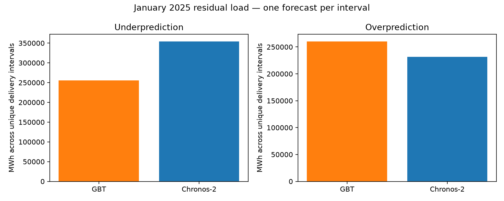

# Model results and comparable evaluations

Updated 2026-11-25 after integrating `origin/main` at `f2e18d8`.

## Reviewed runs

| Run | Target and final test | Forecast schedule | Results |
| --- | --- | --- | --- |
| [GBT matched to Chronos-2](../outputs/runs/20261125T085051149324Z_gradient-boosting-residual-load-january-2025_afl2t6ia/run_manifest.json) | Residual load, January 2025 | 96 quarter-hours every hour; 721 origins | [metrics](../outputs/runs/20261125T085051149324Z_gradient-boosting-residual-load-january-2025_afl2t6ia/metrics/final_test.json), [forecasts](../outputs/runs/20261125T085051149324Z_gradient-boosting-residual-load-january-2025_afl2t6ia/predictions/final_test.csv), [plots](../outputs/runs/20261125T085051149324Z_gradient-boosting-residual-load-january-2025_afl2t6ia/plots) |
| [Chronos-2 January reference](../outputs/runs/20261117T112048694811Z_chronos2-15min-evaluation_9284b2e63425/run_manifest.json) | Same residual-load labels and January test | Same 721 origins and horizons | [metrics](../outputs/runs/20261117T112048694811Z_chronos2-15min-evaluation_9284b2e63425/metrics/final_test.json), [forecasts](../outputs/runs/20261117T112048694811Z_chronos2-15min-evaluation_9284b2e63425/predictions/final_test.csv), [plots](../outputs/runs/20261117T112048694811Z_chronos2-15min-evaluation_9284b2e63425/plots) |
| [Retained GBT grid-load run](../outputs/runs/20261113T123354683990Z_gradient-boosting-final-grid-load-15min-evaluation_395ad9bfa94a/run_manifest.json) | Grid load, January-November 2025 | 96 quarter-hours once per day | [TransnetBW comparison](transnetbw_2025_final_comparison.md), [metrics](../outputs/runs/20261113T123354683990Z_gradient-boosting-final-grid-load-15min-evaluation_395ad9bfa94a/metrics/transnetbw_summary.json), [aligned forecasts](../outputs/runs/20261113T123354683990Z_gradient-boosting-final-grid-load-15min-evaluation_395ad9bfa94a/predictions/transnetbw_aligned.csv) |

The November 10 Chronos-2 run remains historical. Use the November 17 run above for the January comparison. The grid-load and residual-load results measure different targets; they must not be ranked together.

## Matched January residual-load results

Both models have exactly **69,216 matched origin/target/horizon rows**, with identical actual labels, covering **2,976 unique delivery intervals**. The comparison rejects differing targets, horizons, schedules, keys or labels instead of silently dropping unmatched rows.

| Model | MAE across all forecast pairs (MWh) | RMSE across all forecast pairs (MWh) |
| --- | ---: | ---: |
| GBT | 174.91 | 226.28 |
| Chronos-2 | 182.52 | 253.59 |

Hourly 24-hour forecasts overlap. Their summed errors count the same delivery interval repeatedly. For energy-volume comparison, select the common midnight Europe/Berlin origin each January day (23:00 UTC), then its full 96-step horizon. This gives 31 forecasts and counts each of the 2,976 delivery intervals once. This policy is fixed by origin/time, not chosen by forecast accuracy.

| Model | MAE on daily selection (MWh) | RMSE (MWh) | Underprediction total (MWh) | Overprediction total (MWh) |
| --- | ---: | ---: | ---: | ---: |
| GBT | 173.52 | 225.26 | 255,965.93 | 260,433.19 |
| Chronos-2 | 196.90 | 272.84 | 354,445.57 | 231,540.32 |

Underprediction = max(actual - forecast, 0); overprediction = max(forecast - actual, 0). GBT has less underprediction and more overprediction on this selection. These are forecast-error volumes, not settlement positions or savings.

- [Comparison metrics and source hashes](../outputs/runs/20261125T085051149324Z_gradient-boosting-residual-load-january-2025_afl2t6ia/metrics/chronos2_comparison.json)
- [All matched forecast pairs](../outputs/runs/20261125T085051149324Z_gradient-boosting-residual-load-january-2025_afl2t6ia/predictions/chronos2_matched_pairs.csv)
- [One forecast per delivery interval](../outputs/runs/20261125T085051149324Z_gradient-boosting-residual-load-january-2025_afl2t6ia/predictions/chronos2_matched_delivery.csv)
- [Comparison by horizon](../outputs/runs/20261125T085051149324Z_gradient-boosting-residual-load-january-2025_afl2t6ia/metrics/chronos2_comparison_by_horizon.csv)



The original Chronos CSV is preserved. Comparison metrics are recomputed from its exported actual and prediction values; tiny differences from its original float32 metrics/residuals can result from export precision.

## Training and limits

The new [saved GBT configuration](../outputs/runs/20261125T085051149324Z_gradient-boosting-residual-load-january-2025_afl2t6ia/artifacts/experiment_config.json) changes the target and lagged-load input to residual load, limits the final test to January, and advances origins by four quarter-hours. It retains causal preparation, the 60-minute lag buffer, weather and price lags, and 28 features. The model fits only 2023-2024 data and freezes weights for the test.

A fresh 12-trial Optuna search used the three 2024 validation quarters only. Trial 7 won with mean-fold RMSE 223.09005 MWh. [The HPO run](../outputs/hpo_runs/20261125T084624127450Z_gradient-boosting-residual-load-january-2025-hpo_19b30afa2cb1/run_manifest.json) and [trial table](../outputs/hpo_runs/20261125T084624127450Z_gradient-boosting-residual-load-january-2025-hpo_19b30afa2cb1/artifacts/hpo_trials.csv) record the selection. The saved configuration contains those selected parameters, so `--stage evaluate` reproduces the model without searching again.

This matches final-test target, labels, dates and origins. It does not make model training, validation, features, lookback or observation availability identical: Chronos is pretrained with a 672-row context, while GBT uses 676 rows of lag history and development-trained weights. GBT validation uses three quarterly fits and daily forecast blocks, so its CV mean must not be ranked against Chronos's rolling CV score. January 2025 was already inspected during project development; this is an exploratory comparison.

The retained grid-load benchmark remains separately available. The subsequently supplied TransnetBW exports also contain residual-load forecasts, now compared on the same delivery intervals in the [evaluation overview](../docs/energy_forecasting_evaluation_overview.md#5-final-model-comparison). The [price comparison](../docs/energy_forecasting_evaluation_overview.md#7-day-ahead-purchase-and-settlement-cost-comparison) uses day-ahead procurement and reBAP settlement on the 721 step-96 delivery intervals, with no intraday adjustment.

## Output contract

Every evaluation is self-contained under `outputs/runs/<run_id>/`:

```text
run_manifest.json
artifacts/
  experiment_config.json             # GBT reproducible configuration
  split_manifest.json
  selected_parameters.json
  training_manifest.json             # GBT fitting provenance
  development_features.csv           # GBT development inputs and labels
  first_demo_features.csv             # first inference feature table
metrics/
  cv_validation.json
  final_test.json
  cv_validation_evaluation.csv
  final_test_evaluation.csv
predictions/
  cv_validation.csv
  final_test.csv
plots/
  forecast_example_1.png ... forecast_example_3.png
  final_test_errors_by_horizon.png
  final_test_residual_distribution.png
  final_test_residuals_over_time.png
checkpoints/
  model.joblib                        # GBT; Chronos weights stay in model cache
```

Forecast CSV columns, in order:

```text
split,fold,forecast_origin,cutoff_timestamp,target_timestamp,horizon_step,actual,prediction,residual
```

Times are UTC interval starts; `forecast_origin` is the first delivery interval, and `cutoff_timestamp` is the preceding interval. Neither field verifies the historical publication time of observations. Horizon steps are 1-96. `fold` is blank for final test. Missing original target labels are excluded from scoring and saved separately under `artifacts/unscored_predictions.csv` when present.

Standard metrics include MAE/RMSE and directional totals overall and by horizon/fold. They state that totals aggregate forecast rows. Benchmark-specific outputs use `transnetbw_*` or `chronos2_*` names within these same folders. HPO remains under `outputs/hpo_runs/` with an explicit link from the evaluation manifest.

Prepared GBT tables no longer go into `Dataset/processed/`, checkpoints are no longer duplicated under `outputs/trained_models/`, and comparison files no longer go into `outputs/benchmarks/` or `reports/`. Reports contain navigation and interpretation. The retained grid-load run was migrated without changing any actual or predicted values; its [migration audit](../outputs/runs/20261113T123354683990Z_gradient-boosting-final-grid-load-15min-evaluation_395ad9bfa94a/artifacts/output_standardization.json) records the CSV hashes before/after schema normalization. Historical timings that were never recorded remain blank.

## Reproduce

Run from the repository root with the project environment active. The loader accepts the saved JSON configuration as well as YAML:

```powershell
$env:OMP_NUM_THREADS = '1'
$env:OPENBLAS_NUM_THREADS = '1'
$env:MKL_NUM_THREADS = '1'
python main.py --stage evaluate --exp-cfg outputs/runs/20261125T085051149324Z_gradient-boosting-residual-load-january-2025_afl2t6ia/artifacts/experiment_config.json
```

Replace `GBT_RUN` below with the new evaluation directory printed by that command; the reviewed saved run can also be used directly:

```powershell
python -m src.evaluation.compare_runs --gbt-run GBT_RUN --chronos-run outputs/runs/20261117T112048694811Z_chronos2-15min-evaluation_9284b2e63425
```

Use `--stage all` to repeat development HPO and evaluation. The legacy grid-load config remains `configs/experiments/gradient_boosting.yaml`. To upgrade an older output schema without fitting:

```powershell
python -m src.outputs.standardize_run --run RUN_DIRECTORY
```

This deliberately updates the chosen run's derived outputs and writes an audit; it preserves actual and predicted values. The TransnetBW command in [the grid-load report](transnetbw_2025_final_comparison.md#reproduce-and-inspect) saves all its outputs inside the specified prediction run by default.

## Verification

27 tests passed, including hourly overlap, test-boundary containment, source isolation, causal inference and rejection of mismatched comparisons. A fresh grid-load evaluation reproduced all 32,064 retained predictions exactly; a second residual-load evaluation reproduced all 69,216 new predictions exactly. The saved demo notebook executed successfully. [Verification details and package versions](../outputs/runs/20261125T085051149324Z_gradient-boosting-residual-load-january-2025_afl2t6ia/artifacts/verification.json).
