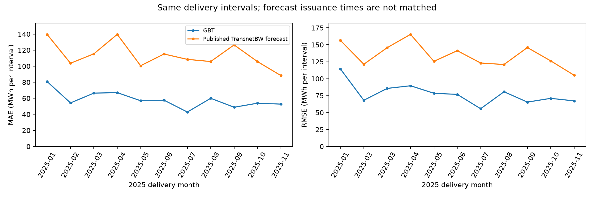

# Gradient boosting: final setup and TransnetBW comparison

Evaluated 2026-11-13 using saved predictions. Setup and documentation consolidated 2026-11-14. This is the main report for the project gradient boosting experiment.

## Coverage and matching

- Source run: `20261113T123354683990Z_gradient-boosting-final-grid-load-15min-evaluation_395ad9bfa94a`.
- 32,064 identical quarter-hour intervals, 2025-01-01T00:00:00+01:00 through 2025-11-30T23:45:00+01:00 (interval starts).
- 334 GBT forecast origins; each predicts 96 intervals.
- 0 saved prediction rows excluded for missing data.
- Downloaded actual grid load matches saved test labels exactly within 1e-8 MWh.
- SMARD files use MWh per quarter-hour already; no power-to-energy conversion applied.
- UTC joins disambiguate repeated autumn local times. No interpolation of benchmark forecasts.
- Both exports use `grid load [MWh] Original resolutions`. The TransnetBW region
  comes from the supplied download selection; the CSV headers do not encode it.

## Results

| Forecast | MAE (MWh/interval) | RMSE (MWh/interval) | Underprediction total (MWh) | Overprediction total (MWh) |
| --- | ---: | ---: | ---: | ---: |
| GBT | 58.36 | 79.08 | 808,253.49 | 1,063,021.11 |
| Published TransnetBW forecast | 113.55 | 135.40 | 185,020.43 | 3,455,978.70 |

GBT minus published forecast relative error: **-48.61% MAE** and **-41.60% RMSE**
(positive means GBT has higher error). GBT has lower absolute error in
78.24% of scored intervals; this is descriptive, not a significance test.
Underprediction is max(actual minus forecast, 0); overprediction is the reverse.
These measure forecasting errors, not actual purchases or balancing-account positions.

The published series overpredicts in 89.70% of intervals,
with signed mean error (actual minus forecast) -102.01 MWh.
GBT's signed mean error is -7.95 MWh.
This systematic difference deserves investigation; its cause is not established here.

## Monthly MAE

| Month | GBT MAE | Published forecast MAE | Intervals |
| --- | ---: | ---: | ---: |
| 2025-01 | 80.80 | 139.57 | 2,976 |
| 2025-02 | 54.24 | 103.65 | 2,688 |
| 2025-03 | 66.44 | 115.37 | 2,972 |
| 2025-04 | 67.02 | 139.62 | 2,880 |
| 2025-05 | 56.93 | 100.53 | 2,976 |
| 2025-06 | 57.66 | 115.14 | 2,880 |
| 2025-07 | 42.86 | 108.47 | 2,976 |
| 2025-08 | 59.97 | 105.79 | 2,976 |
| 2025-09 | 48.85 | 126.46 | 2,880 |
| 2025-10 | 53.84 | 105.70 | 2,980 |
| 2025-11 | 52.73 | 88.34 | 2,880 |

Coverage is limited to the dates above; no forecasts are extrapolated into missing months.

## What this answers

The saved GBT does forecast held-out 2025 load: weights were fitted on 2023-2024,
and prior 2025 observations refresh lagged inputs at later daily origins without
retraining. Its accuracy can be scored against the published forecast on the same
actual load and delivery timestamps. This report provides that preliminary comparison.
It does not establish superiority under identical forecast-time information.

The final weights were saved before opening demo observations. Forecasts use
earlier 2025 observations only to refresh historical features; weights stay fixed.
Although 2025 is excluded from this model's fitting and selection, it had already
been inspected during project development and is not a never-inspected research holdout.

## Limits to the operational comparison

- GBT issues a rolling next-24-hour forecast at 23:00 UTC (midnight in winter,
  01:00 in summer); the benchmark is a day-ahead delivery-day forecast. The model
  may have more recent information. Lead times and issuance times are not matched.
- CSVs contain delivery timestamps but no forecast issue time or revision identifier.
  We have not established that the downloaded benchmark is the original forecast
  available at the intended cutoff.
- GBT uses lagged historical temperature, not archived weather forecasts. Different
  available feature sets are a limitation when interpreting an operational comparison.
- GBT's lag features include a configured 60-minute availability buffer. This does not verify historical publication vintages or later revisions.
- ARIMA and Chronos were not evaluated on this identical 2025 setup here.
- Forecast accuracy is not procurement savings; no reBAP or cost model is used.

Next: preserve this preliminary result, align issuance/horizons and data availability,
add archived weather forecasts, and rerun all models under the common protocol.
Once results from 2025 inform changes, further 2025 comparisons are exploratory;
reserve another untouched period for a confirmatory final test.

SMARD identifies forecasted consumption as a day-ahead total-load forecast.
ENTSO-E documents forecast revisions and subsequent updates of TransnetBW actual
load using settlement data. These support treating this as a retrospective
comparison rather than a reconstruction of the original information sets.
See the [SMARD user guide](https://www.smard.de/resource/blob/205652/63fcff2c9813096fa2229d769da164ef/smard-user-guide-09-2021-data.pdf)
and [ENTSO-E load data definitions](https://transparencyplatform.zendesk.com/hc/en-us/articles/16647979768084-Actual-Total-Load-Day-ahead-Per-Bidding-Zone-6-1-A-6-1-B).

## Implementation and checkpoint

There is **no single serialized sklearn preprocessing Pipeline**. The process is explicit Python functions plus configuration and checkpoint state:

| File | Responsibility |
| --- | --- |
| [Experiment config](../configs/experiments/gradient_boosting.yaml) | Source paths, selected raw columns, timezones, lags, delay, splits and horizons |
| [process.py](../src/models/gradient_boosting/process.py) | Parse/join sources, causal filling, holiday handling, timestamp checks and lag construction |
| [add_seasonal_features.py](../preprocessing/add_seasonal_features.py) | Shared 17 calendar columns |
| [run.py](../src/models/gradient_boosting/run.py) | Development preparation, HPO, final fit, checkpoint and replay |
| [inference.py](../src/models/gradient_boosting/inference.py) | Reload checkpoint, bound history, rebuild/check feature schema, predict |
| [Final demo notebook](../preprocessing/gbt_final_demo.ipynb) | Executed example of inference from the saved checkpoint |

Like Chronos-2, this model uses `run.py` for orchestration, `process.py` for preparation and `inference.py` for prediction. GBT learns weights locally, so it retains development-only hyperparameter search and its 2023-2024 / 2025 split. Chronos-2 uses pretrained weights and a different target/split; its scores cannot be directly ranked against this result.

The [saved model bundle](../outputs/runs/20261113T123354683990Z_gradient-boosting-final-grid-load-15min-evaluation_395ad9bfa94a/checkpoints/model.joblib) contains the fitted `YfromX` forecaster, feature version and ordered names, dataset settings, holiday dates, horizon, training row count/cutoff, imputation sums/counts, last 676 prepared history rows and experiment signature. The code and compatible dependencies are still needed to recreate preprocessing. A joblib file alone does not embed the Python implementations.

## Source variables

The prediction target is **`grid load [MWh]` per quarter-hour**, not residual load or MW.

| Source under `Dataset/raw/csv/` | Selected variables | Use |
| --- | --- | --- |
| `Actual_consumption_2023_2024_Quarterhour.csv` | `Start date`, `grid load [MWh]` | Timestamp, target and lagged load |
| `open-meteo-48.83N9.15E293m_2023_2024.csv` | `time`, `temperature_2m (°C)`, `wind_speed_10m (km/h)`, `dew_point_2m (°C)` | Timestamp and three historical weather inputs at the supplied location |
| `Day-ahead_prices_2023_2024_Quarterhour.csv` | `Start date`, `Germany/Luxembourg [€/MWh]` | Timestamp and historical price input |
| `df_holiday.csv` | `Datum` | BW holiday indicator; absent 2025 dates generated with `holidays.Germany(subdiv="BW")` |

The corresponding `*_2025.csv` files provide demo observations. Their rows do not enter HPO or fitting. Later demo forecasts can use earlier 2025 observations as history.

Other columns in the new files are **not used**: residual load, pumped storage and load including pumped storage; humidity, precipitation, radiation, sunshine duration and weather code; neighbouring-country prices; `End date`; and the holiday name. The official TransnetBW forecast is an evaluation benchmark, not a training feature. The model contains no archived weather forecasts, generation forecasts, intraday prices or reBAP input.

## Preprocessing steps

1. Parse consumption and prices in `Europe/Berlin`; parse weather using its configured fixed `+02:00` offset. Convert everything to UTC. Validate sorted, unique, continuous 15-minute timestamps; disambiguate the repeated autumn hour.
2. Use consumption timestamps as the master grid and left-join the selected weather and price columns. Convert numeric values, replace infinities with missing values, and treat negative wind speed as invalid. Negative electricity prices remain valid.
3. Fill missing historical inputs with the **mean of strictly preceding valid observations** of that column. This is an expanding historical mean, not forward filling or interpolation. Sums/counts from development initialize demo filling. Missing original target labels are retained separately and excluded from fitting/scoring. No leading gap without usable history is silently accepted.
4. Build the ten lag features by timestamp. Nominal lags 24h and 168h each receive a 60-minute delay: actual lookups are **25h and 169h before delivery time**. The longest requires 676 quarter-hours of initial history. A lag name containing `24h` therefore does not mean an effective 24-hour offset in this experiment.
5. Generate the calendar features in `Europe/Berlin`, including DST, and add `is_holiday` for the local delivery date.
6. Pass the ordered numeric columns directly to the estimator. No standardization, normalization, one-hot encoding, PCA or feature selection is applied.

The saved preparation audit reports four unmatched weather timestamps at the end of each split, filled causally in the three selected weather columns. Load and selected prices have no missing observations. The development source has 70,176 rows; after 676 warm-up rows, **69,500 observed training labels** remain.

## All 28 training and HPO features

HPO used **the same fixed 28 features as the final fit**. There was no feature-subset search or feature-importance-based selection.

| Group | Exact feature names | Count |
| --- | --- | ---: |
| Load history | `load_lag_24h_delay_60m`, `load_lag_168h_delay_60m` | 2 |
| Temperature history | `temperature_lag_24h_delay_60m`, `temperature_lag_168h_delay_60m` | 2 |
| Wind history | `wind_lag_24h_delay_60m`, `wind_lag_168h_delay_60m` | 2 |
| Dew-point history | `dew_point_lag_24h_delay_60m`, `dew_point_lag_168h_delay_60m` | 2 |
| Price history | `price_lag_24h_delay_60m`, `price_lag_168h_delay_60m` | 2 |
| Calendar | `calendar_second_of_minute_sin`, `calendar_second_of_minute_cos` | 2 |
| Calendar | `calendar_minute_of_hour_sin`, `calendar_minute_of_hour_cos` | 2 |
| Calendar | `calendar_hour_of_day_sin`, `calendar_hour_of_day_cos` | 2 |
| Calendar | `calendar_day_of_week_sin`, `calendar_day_of_week_cos` | 2 |
| Calendar | `calendar_day_of_month_sin`, `calendar_day_of_month_cos` | 2 |
| Calendar | `calendar_day_of_year_sin`, `calendar_day_of_year_cos` | 2 |
| Calendar | `calendar_week_of_year_sin`, `calendar_week_of_year_cos` | 2 |
| Calendar | `calendar_month_of_year_sin`, `calendar_month_of_year_cos` | 2 |
| Calendar | `calendar_year` | 1 |
| Holiday | `is_holiday` | 1 |

The timestamp is the index and the contemporaneous grid load is the label; neither is an additional input column. There is no explicit horizon-step feature. Weekday is encoded cyclically; there is no separate weekend flag in this final schema.

Calendar pairs use the shared function's `sin/cos(2π × component / (period−1))` convention, including zero-based day/month/week offsets. This differs from conventional period denominators; it was inherited, not optimized. Seconds are always zero on this grid, so that sine/cosine pair is constant. Tree models also do not extrapolate a numeric year trend beyond the training years. These are design limitations to review for a future model, not changes made to the frozen experiment.

Inspect the exact ordered training table in [gbt_final_development.csv](../Dataset/processed/gbt_final_development.csv) or the first forecast's [feature table](../outputs/runs/20261113T123354683990Z_gradient-boosting-final-grid-load-15min-evaluation_395ad9bfa94a/artifacts/first_demo_features.csv).

## Hyperparameter selection

Yes: **12 Optuna trials**, `TPESampler(seed=42)`, minimizing the arithmetic mean of the three validation-fold RMSE values. The seed fixes the sampler's randomness; it does not make twelve trials exhaustive. The first ten trials use TPE's default startup sampling, so this is a small search with only two later TPE-guided trials. No alternative model families or feature sets were searched.

| Parameter | Search range in experiment YAML | Selected, trial 11 (zero-based) |
| --- | --- | --- |
| `learning_rate` | 0.03–0.2, logarithmic | 0.05337193482375701 |
| `max_depth` | Integer 3–10 | 8 |
| `max_leaf_nodes` | Integer 8–63 | 59 |
| `min_samples_leaf` | Integer 20–100 | 64 |
| `max_iter` | 100, 150, 200, 250, 300 | 100 |
| `l2_regularization` | 0.01–10, logarithmic | 0.01574118047380971 |
| `random_state` | Fixed, not searched | 42 |
| `early_stopping` | Fixed off in code | `False` |

The estimator is `HistGradientBoostingRegressor`, wrapped in sktime `YfromX`: **one pooled tabular regression model** serves all 96 horizon steps. Its default loss is squared error; model selection uses RMSE, not a monetary objective. Parameters outside the explicit configuration use library defaults. The single experiment YAML stores the selected values under `parameters` and the original search space under `hpo`. Evaluation without `--hpo-run` uses these selected values. `--stage hpo` and `--stage all` explicitly run the search again.

| Fold | Fit on usable history from January 2023 up to | Validate on |
| --- | --- | --- |
| 1 | April 1, 2024, exclusive | April–June 2024 |
| 2 | July 1, 2024, exclusive | July–September 2024 |
| 3 | October 1, 2024, exclusive | October–December 2024 |

Weights stay fixed within each validation quarter while historical lag inputs refresh. Only full 96-interval blocks are scored; four trailing intervals in the final validation fold are omitted because local-year boundaries cross DST offsets. Final fitting includes all usable development labels.

The winning mean-fold RMSE is **72.71880283576692 MWh**. All 12 trials completed. Read the [selected parameters](../outputs/hpo_runs/20261113T123333192472Z_gradient-boosting-final-grid-load-15min-hpo_af8e41657b18/artifacts/selected_parameters.json) and [complete trial history](../outputs/hpo_runs/20261113T123333192472Z_gradient-boosting-final-grid-load-15min-hpo_af8e41657b18/artifacts/hpo_trials.csv). The [experiment YAML](../configs/experiments/gradient_boosting.yaml) defines the search; `run.py` defines the objective and folds.

## Run the experiment

The only GBT configuration is [configs/experiments/gradient_boosting.yaml](../configs/experiments/gradient_boosting.yaml). It contains the data contract, splits, selected model parameters and optional HPO settings. Omit `--mdl-cfg`, as with Chronos-2.

```powershell
$env:OMP_NUM_THREADS = '1'
$env:OPENBLAS_NUM_THREADS = '1'
$env:MKL_NUM_THREADS = '1'
python main.py --stage evaluate --exp-cfg configs/experiments/gradient_boosting.yaml
```

This refits with the selected parameters and replays the 2025 data. Use `--stage hpo` to search only on development data, or `--stage all` to search, fit and evaluate. To reuse the saved search with source/feature compatibility checks, append:

```text
--hpo-run outputs/hpo_runs/20261113T123333192472Z_gradient-boosting-final-grid-load-15min-hpo_af8e41657b18
```

For inference without fitting, use [the demo notebook](../preprocessing/gbt_final_demo.ipynb). It loads the saved checkpoint and reproduces the first two forecasts, initially using only 2024 history, then adding newly observed first-day values. Training and HPO save numerical artifacts without generating plots. The comparison command below generates the single retained figure.

The [saved run manifest](../outputs/runs/20261113T123354683990Z_gradient-boosting-final-grid-load-15min-evaluation_395ad9bfa94a/run_manifest.json) records source hashes, feature order and preprocessing counts. The [verification audit](../outputs/runs/20261113T123354683990Z_gradient-boosting-final-grid-load-15min-evaluation_395ad9bfa94a/artifacts/verification.json) records the original environment and model checks. Immutable run snapshots retain the configuration names used when the experiment was executed; the commands here use the consolidated setup. The final evaluation, HPO selection, checkpoint and benchmark snapshots under `outputs/` are included for review. Newly generated runs remain ignored by Git.

## Artifacts

`aligned_predictions.csv`, `monthly_metrics.csv` and `summary.json` (including input hashes) are saved in `outputs/benchmarks/transnetbw_2025_gbt_final/`. The only GBT plot is `reports/transnetbw_2025_final_comparison.png`.

## Reproduce and inspect

Run commands from the repository root with the Python environment activated. The
SMARD exports live in `Dataset/benchmarks/transnetbw/`; see the
[dataset overview](../Dataset/README.md#transnetbw-comparison-inputs). The dated
prediction path below identifies the evaluated run included in this repository.
The comparison and demo notebook can use that saved run directly. After a new
evaluation, replace the dated run directory with the newly created directory under
`outputs/runs/`.

```powershell
python -m src.evaluation.compare_operational --predictions outputs/runs/20261113T123354683990Z_gradient-boosting-final-grid-load-15min-evaluation_395ad9bfa94a/predictions/final_test.csv --actual Dataset/benchmarks/transnetbw/actual_consumption.csv --forecast Dataset/benchmarks/transnetbw/forecasted_consumption.csv --output outputs/benchmarks/transnetbw_2025_gbt_final
```

[Aligned interval predictions](../outputs/benchmarks/transnetbw_2025_gbt_final/aligned_predictions.csv),
[metrics and input hashes](../outputs/benchmarks/transnetbw_2025_gbt_final/summary.json),
and [monthly metrics](../outputs/benchmarks/transnetbw_2025_gbt_final/monthly_metrics.csv).



The comparison contains only GBT and the published forecast; learned model weights and saved predictions remain unchanged.
GBT's larger underprediction total means lower MAE should not be interpreted as fewer
shortages under an asymmetric cost policy. No significance test was performed;
quarter-hour errors are serially dependent.

## Cleanup verification (2026-11-14)

The consolidated setup passes 23 current tests. A fresh evaluation using the single
experiment YAML reproduced all 32,064 saved final predictions exactly and matched
the retained HPO experiment signature. The saved prediction file hash is unchanged. Checkpoint packaging is described below. The updated demo notebook executes successfully and reproduces
its first two forecasts. GBT training/HPO generate no plot images; comparison output
writes the single figure shown above. Tests for removed experiment implementations
were removed with their implementations.

Path portability was verified by reloading the exported configuration under a different checkout root. The comparison command was rerun using the repository benchmark files and reproduced the reported scores.

## Review snapshot packaging (2026-11-15)

The retained checkpoint was reserialized with repository-relative source paths before sharing. No fitting or weight updates occurred. Both saved checkpoint copies are identical; the verification JSON records the original file hash, the packaged file hash and the unchanged learned-estimator hash. All report artifact links refer to the included final-run snapshots. Generated HTML previews remain local.

PR validation on the updated main branch: 24 tests passed; the portable checkpoint reproduced all 32,064 saved predictions exactly, and every demo notebook code cell executed successfully.
